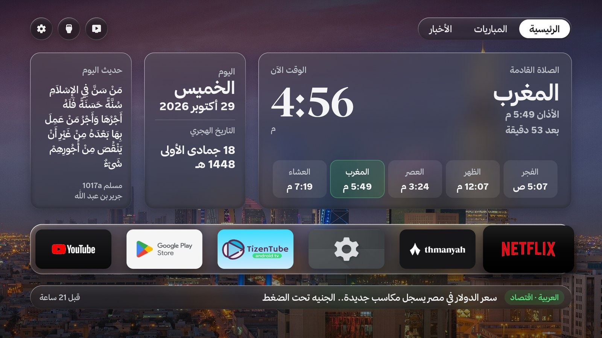
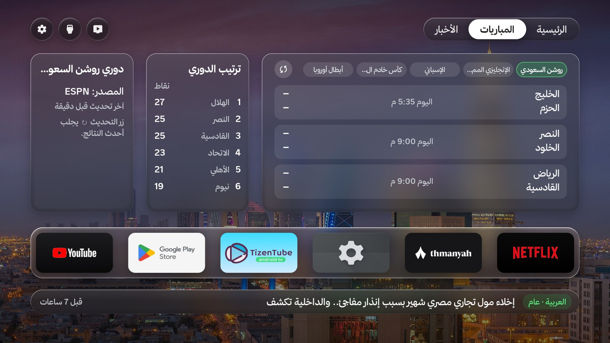
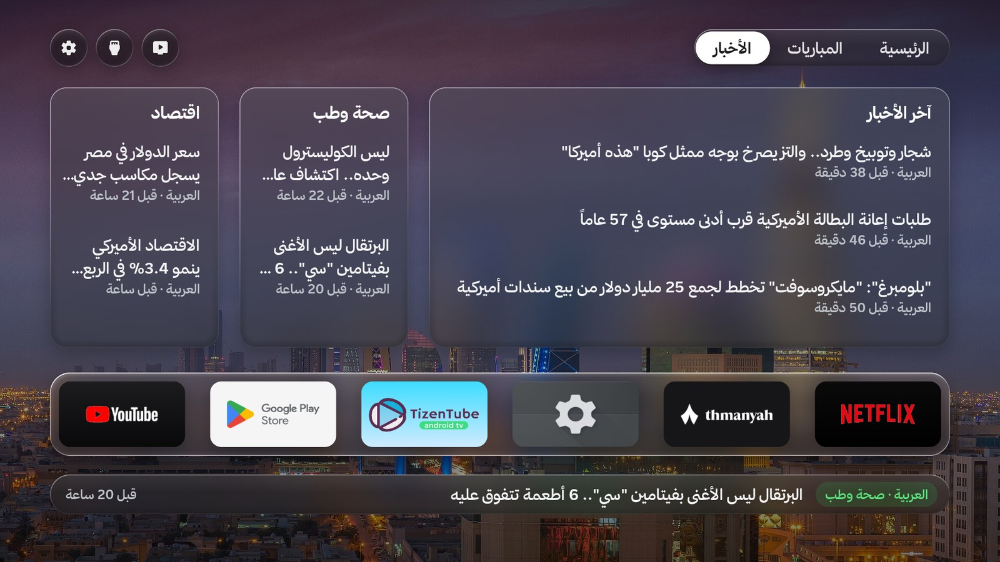
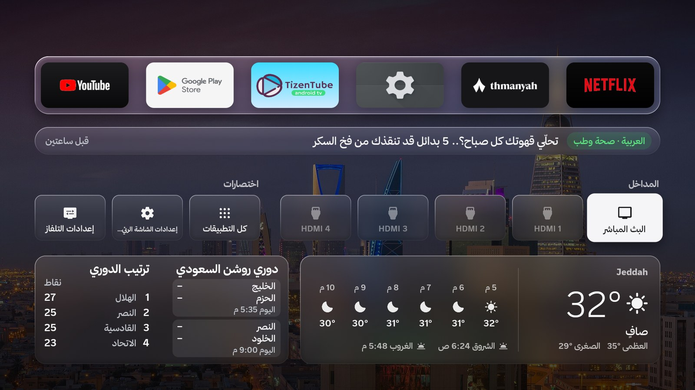
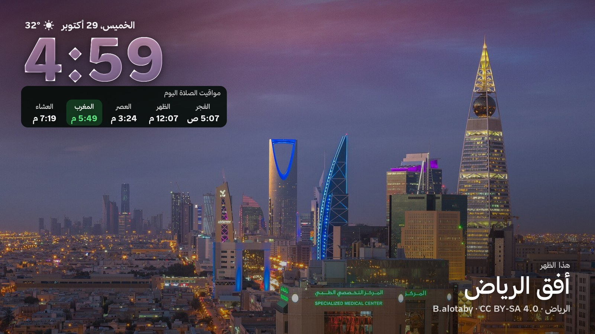
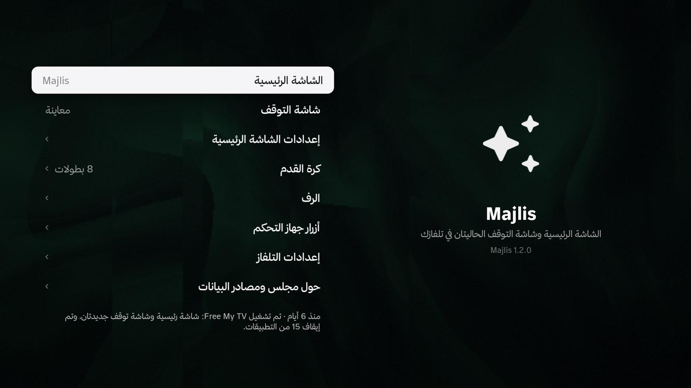

<div align="center">

# Majlis · مجلس

**An Arabic-first home screen for Android TV.**
Umm al-Qura prayer times with iqama, the Hijri date, a Qur'an verse or a verified hadith every day,
the Saudi Pro League, an Arabic news ticker, and 39 Saudi wallpapers that change daily.

[العربية](README.ar.md) · [Install](docs/INSTALL.md) · [Troubleshooting](docs/TROUBLESHOOTING.md) · [How it works](docs/ARCHITECTURE.md)

</div>



<sub>Design mockup — the shipping UI follows this design.</sub>

## Ask your agent

Majlis is installed by your coding agent, from a single sentence. It works with Claude Code,
Codex, Cursor or Hermes — the agent follows [`AGENTS.md`](AGENTS.md), and every device decision is
made by the `./tv` tool, so the result is the same in every model.

**Install**

> Install Majlis on my Android TV. Follow https://github.com/SulaimanBaeisa/majlis-tv/blob/main/AGENTS.md
> exactly — do not improvise adb commands. My TV's IP is 192.168.1.50 and my city is Jeddah.

**Update**

> Update Majlis on my TV (192.168.1.50) from https://github.com/SulaimanBaeisa/majlis-tv — follow the
> Update section of AGENTS.md exactly.

**Roll back**

> Put the original home screen back on my TV (192.168.1.50), following the Rollback section of
> https://github.com/SulaimanBaeisa/majlis-tv/blob/main/AGENTS.md.

## What it does

- **Right-to-left, Arabic first.** Built as an Arabic home screen, not translated into one:
  mirrored layout, Arabic typography, Western digits, correct bidi for app names.
- **Prayer times on the TV, offline.** Umm al-Qura calculation for your city, the next prayer, and
  the iqama countdown (`iqama=25,20,20,10,20`, editable in `config.properties`). Friday shows
  الجمعة without a countdown.
- **A daily card.** A Qur'an verse or a verified hadith (60 hadith, each with its source and page
  hash in `docs/religious/hadith-sources.json`), alternating by local date.
- **Saudi Pro League.** Live and upcoming matches plus the top six, from ESPN's public JSON.
- **Arabic news ticker.** Al Arabiya / Al Hadath headlines through Google News RSS.
- **A wallpaper a day.** 39 photos of Saudi cities and heritage sites, with per-photo credits and
  licences in [PHOTO-CREDITS.md](PHOTO-CREDITS.md).
- **A screensaver and an adhan overlay** that disappears after about a minute.
- **One button back.** `Original` restores the stock launcher, recommendations, backdrop and
  screensaver. Nothing is uninstalled.

## Screens

| Home | Matches |
|:---:|:---:|
|  |  |
| **News** | **Drawer** |
|  |  |
| **Screensaver** | **Settings** |
|  |  |

All six are captures from a TCL Smart TV Pro on Android 14 running Majlis 1.2.0.

## Supported TVs

| Brand | Tested on | Android | Notes |
|---|---|---|---|
| Sony BRAVIA | KD-55X9000H | 12 | profile `sony`; TV input stays enabled |
| TCL Google TV | Smart TV Pro G08 | 14 | profile `tcl`; survives `TclAppBoot` |
| Changhong / Classpro | AI PONT | 11 | profile `changhong`; separate screensaver process |
| Other Android TV / Google TV | — | 9–14 | profile `generic`; verify before trusting |

## What changes on the TV

- Majlis becomes the home screen and screensaver.
- Three stock packages are disabled — never uninstalled: the stock launcher, its recommendations,
  and the stock screensaver/backdrop.
- The overlay and exact-alarm permissions are granted for the adhan pop-up.
- `Original` in Majlis's settings reverses all of it.

## Install without an agent

```bash
git clone https://github.com/SulaimanBaeisa/majlis-tv && cd majlis-tv
./tv doctor
./tv build --city "Jeddah"
./tv install --ip 192.168.1.50
./tv switch --ip 192.168.1.50 --to free --wait 180   # then tap Majlis on the TV
./tv verify --ip 192.168.1.50 --mode free --apk Majlis.apk
```

Requires: Python 3.9+, JDK 17, Android SDK build-tools 34 + platform 34, adb. `./tv doctor` prints
the exact install command for what is missing. No Gradle, no Android Studio.

## Update and roll back

```bash
./tv update --ip 192.168.1.50 --city "Jeddah"
./tv rollback --ip 192.168.1.50
```

Updates are source builds, signed with the key on your machine (see [docs/SIGNING.md](docs/SIGNING.md)).
There is no silent self-updater and no background download.

## Settings

`config.properties` (created by the first build, never committed): city/latitude/longitude,
language (`ar`, `en`, `pt`, `es`, `auto`), iqama minutes, temperature unit, crypto card, and the
optional TMDB key for trending picks. The home screen works without any key.

## Build and test

```bash
bash tests/run.sh                                # ALL-PASS
bash tests/check_surface.sh                      # SURFACE-OK (permissions + hosts frozen)
python3 tests/check_daily_sources.py             # religious sources unchanged
python3 -m unittest discover -s tests/tools -v   # installer unit tests, no TV needed
bash tests/check_brand.sh                        # BRAND-OK
```

## Privacy

The app talks only to: `api.open-meteo.com` (weather), `site.api.espn.com` (league),
`news.google.com` (ticker), `api.themoviedb.org` / `image.tmdb.org` (optional picks),
`api.binance.com` (optional crypto), `android.googlesource.com` (Hijri data).
No analytics, no accounts, no ads. `tests/check_surface.sh` fails if this list changes.

## License and credits

MIT — see [LICENSE](LICENSE) and [NOTICE](NOTICE). Forked from
[Free My TV](https://github.com/simbasjungles/free-my-tv) (MIT).
Photographs keep their own licences: [PHOTO-CREDITS.md](PHOTO-CREDITS.md).
Qur'an and hadith texts: [docs/religious/hadith-sources.json](docs/religious/hadith-sources.json).
The Thmanyah fonts are **not** part of this repository and are not redistributed.
